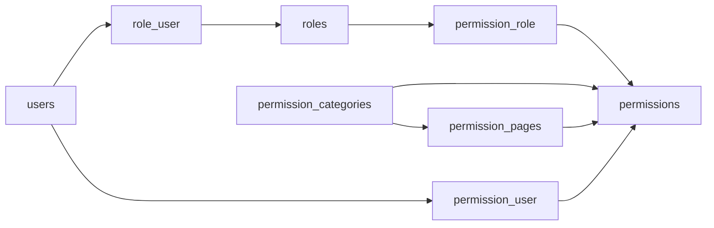

# কাস্টম Role ও Permission ব্যবস্থা: পরিকল্পনা ও বাস্তবায়ন

## উদ্দেশ্য ও নির্ধারিত scope

Spatie Laravel Permission-এর পরিবর্তে প্রকল্পের নিজস্ব role-permission ব্যবস্থা ব্যবহার করা হয়েছে। সরাসরি `user_id` দিয়ে সম্পর্ক এবং আলাদা `permission_categories` টেবিল রয়েছে। Spatie Activitylog আলাদা package; audit log-এর জন্য সেটি রাখা হয়েছে।

ব্যবহারকারীর নির্বাচিত scope: **category → page → action permission**, Dashboard card visibility এবং **নিজের তৈরি User/Role অনুযায়ী creator scope**। বিভাগ বা নিজের ক্লাস অনুযায়ী অন্য মডিউলের record সীমা এই ধাপে প্রযোজ্য নয়। অন্য account বা role পরিবর্তন করে নিজের চেয়ে বেশি ক্ষমতা নেওয়া ঠেকাতে management Policies রয়েছে।

## টেবিলের সম্পর্ক



| টেবিল | কাজ |
|---|---|
| `roles` | স্থায়ী role key, প্রদর্শিত নাম, description ও immutable `created_by` |
| `permission_categories` | মডিউল অনুযায়ী permission সাজানো |
| `permission_pages` | category-এর অধীনে page-এর স্থায়ী key, নাম ও serial order |
| `permissions` | স্থায়ী permission key, label, category, page, action ও sort order |
| `role_user` | `user_id` ও `role_id` দিয়ে role assignment |
| `permission_role` | `role_id` ও `permission_id` দিয়ে role-এর অনুমতি |
| `permission_user` | বিশেষ ক্ষেত্রে user-কে সরাসরি অতিরিক্ত অনুমতি |

মূল ব্যবস্থায় সরাসরি user foreign key ব্যবহার হয়। পুরোনো package-এর config, table-creation migration, conversion migration এবং মূল seeder সরানো হয়েছে। Obsolete backup tables পরিষ্কার করার আগে private JSON backup নেওয়া হয়।

`users.created_by` ও `roles.created_by` সরাসরি creator user-এর foreign key। User/Role তৈরি হলে server authenticated creator-এর ID বসায়; request থেকে দেওয়া creator ID গ্রহণ করে না। Editing-এ creator বদলায় না; duplicate role-এর creator copier।

## অংশ অনুযায়ী অগ্রগতি

- [x] **অংশ ১ — Schema ও migration:** সরাসরি কাস্টম টেবিল তৈরি, foreign key, categories এবং existing custom schema/grants preservation।
- [x] **অংশ ২ — Models ও authorization:** custom relationships, Laravel Gate, management Policies, request-এর মধ্যে permission lookup cache, পরিবর্তনের পর cache reset ও audit log।
- [x] **অংশ ৩ — Backend enforcement:** authenticated application route-এর access rule; অজানা route নিষিদ্ধ; inactive/locked account নিষিদ্ধ। প্রাথমিক verification-এ ৩০২টি route অন্তর্ভুক্ত ছিল।
- [x] **অংশ ৪ — Management UI:** দুই কলামের searchable role workspace, modal থেকে role তৈরি, category/action selection ও permission save; user details-এ effective permission-এর উৎস দেখানো। পুরোনো category/permission CRUD এবং role duplication endpoint-ও রয়েছে।
- [x] **অংশ ৫ — Project integration:** users, student/teacher account creation, seeders, dashboard, sidebar এবং action visibility নতুন ব্যবস্থায় যুক্ত।
- [x] **অংশ ৬ — মূল বাস্তবায়নের verification:** PHP authorization ও migration tests, MySQL data preservation, screen HTTP checks, Composer ও frontend build সম্পন্ন; নিচে সেই পরীক্ষার record রয়েছে। পরবর্তী ছোট UI পরিবর্তনে পুরো suite পুনরায় চালানো হয়নি।
- [ ] **পরবর্তী নির্ধারিত কাজ — SweetAlert:** create/save success ও প্রয়োজনীয় notification পরে যুক্ত করা হবে।

## গুরুত্বপূর্ণ আচরণ

- এক user-এর একাধিক role থাকতে পারে; তাদের permission যোগ হয়।
- `permission_user` অতিরিক্ত অনুমতি দেয়। এটি role থেকে পাওয়া অনুমতি বাতিল করে না।
- `view`, `create`, `edit`, `delete`, `approve`, `publish`, `issue`, `return`, `generate` ইত্যাদি আলাদা action হিসেবে সংযুক্ত।
- Permission key globally unique এবং স্থায়ী। Label ও category বদলালেও existing grants থাকে।
- Role key স্থায়ী; display name ও description পরিবর্তনযোগ্য। পুরোনো role key-ও সংরক্ষিত।
- `super_admin` role সব registered permission পায়; অজানা বা mapping ছাড়া route পায় না।
- `super_admin`, `teacher`, `student` system role মুছে ফেলা যায় না। `super_admin` role editor থেকে পরিবর্তন করা যায় না।
- Assigned role এবং application permission ইচ্ছামতো delete করা যায় না।
- সাধারণ administrator নিজের কাছে নেই এমন permission দিতে পারেন না। Privileged role-management grants দেওয়ার জন্য super administrator প্রয়োজন।
- বেশি ক্ষমতাসম্পন্ন অন্য account-এর password, role বা status পরিবর্তন করে access নেওয়া নিষিদ্ধ।
- শেষ সক্রিয় super administrator-কে demote, deactivate বা delete করা যায় না; নিজের profile delete-এর ক্ষেত্রেও এটি প্রযোজ্য।
- Dashboard এবং buttons/menu-তে একই access rule ব্যবহার হয়। Reports-এর জন্য report permission-এর সঙ্গে সংশ্লিষ্ট মডিউলের permission-ও লাগে।
- ব্যক্তিগত theme পরিবর্তন session-এ থাকে; সাধারণ user এটি দিয়ে global settings পরিবর্তন করতে পারেন না।

## পুরোনো ডেটা স্থানান্তর

বর্তমান schema migration: `database/migrations/2026_11_21_000000_create_custom_permission_tables.php`

Cleanup migration: `database/migrations/2026_11_21_000001_remove_obsolete_authorization_tables.php`

প্রথম implementation-এ বিদ্যমান MySQL data কাস্টম ব্যবস্থায় স্থানান্তর হয়েছে। নিচের সংখ্যা **প্রাথমিক migration-এর snapshot**; পরে role বা grants পরিবর্তন হলে live সংখ্যা ভিন্ন হবে। সংরক্ষিত ফল:

| বিষয় | ফল |
|---|---|
| ব্যবহারকারী | ১৬ জন সংরক্ষিত |
| Role | ১৮টি; পুরোনো ID ও name সংরক্ষিত |
| User-role assignment | ১৬টি; সব সংরক্ষিত |
| পুরোনো permission | ৬৩টি; পুরোনো ID ও name সংরক্ষিত |
| Migration-এর পর permission | ১৩৮টি |
| Permission category | ৩৬টি |
| পুরোনো role-permission সম্পর্ক | ২৫৩টি; সব সংরক্ষিত |
| Migration-এর পর role-permission সম্পর্ক | ৫৪০টি; নতুন granular grants-সহ |
| পুরোনো direct user permission | সব সংরক্ষিত; এই database-এ সংখ্যা ০ |

প্রথম data conversion-এ existing grants-এর জন্য প্রয়োজনীয় granular permissions যোগ করা হয়েছিল। এখন compatibility expansion code সরানো হয়েছে। `CustomAuthorizationSeeder` সরাসরি custom permission keys দিয়ে নতুন role তৈরি করে; existing customized grants overwrite করে না।

Migration-এর আগে private JSON backup নেওয়া হয়েছে:

`storage/app/private/authorization-backups/permissions-20261121-112441-2f1efc.json`

এই backup-এ authorization tables রয়েছে; user password নেই।

## ব্যবহারের পথ

1. Super administrator হিসেবে login করুন।
2. **Roles & Permissions** পেজের **Create role** modal থেকে role তৈরি করুন বা বাম তালিকা থেকে existing role নির্বাচন করুন।
3. **Edit** চাপুন, প্রয়োজনীয় category ও action নির্বাচন করে একই header-এর **Save** চাপুন। সাধারণভাবে write permission-এর সঙ্গে সংশ্লিষ্ট view permission-ও দিন।
4. **Users** থেকে role assign করুন।
5. User details-এ **Effective Permissions** দেখুন; কোন role বা direct grant থেকে অনুমতি এসেছে তা দেখাবে।

প্রধান কাজের জন্য আলাদা `/permissions` পেজে যাওয়ার প্রয়োজন নেই; navigation থেকে এর link সরানো হয়েছে। পুরোনো `/permissions` পেজ ও CRUD endpoints এবং `/roles/create`, `/roles/{role}/edit` form এখনও সরাসরি URL দিয়ে ব্যবহার করা যায়। এগুলো backend থেকে সরানো হয়নি। নতুন মডিউল যুক্ত করার নিয়ম নিচে দেওয়া আছে।

## নতুন মডিউল কীভাবে যুক্ত করবেন

মূল catalog: `config/authorization.php`; ordered page list: `config/permission-pages.php`। Category নতুন হলে `authorization.categories`-তে entry যোগ করুন। এরপর page list-এর নির্ধারিত জায়গায় উদাহরণের মতো page যোগ করুন:

```php
'student-services' => [
    'category' => 'students',
    'label' => 'Student Services',
    'prefixes' => ['student-services'],
],
```

এই entry বিদ্যমান page array-এর সঙ্গে যোগ করতে হবে; পুরো catalog replace করা যাবে না। Named routes-কে `auth` এবং `AuthorizeModule` middleware-এর অধীনে রাখুন। Standard CRUD route থেকে registry নিজে প্রয়োজনীয় action তৈরি করে: `index/show` → View, `create/store` → Create, `edit/update` → Edit, `destroy` → Delete। Declared page prefix-এর সঙ্গে GET route name হুবহু মিললেও View তৈরি হয়; `.index` বাধ্যতামূলক নয়। বাস্তবে নেই এমন action তৈরি হয় না। এরপর:

```bash
php artisan config:clear
php artisan permissions:sync
```

এই command নতুন capabilities ও page serial register করে; existing role grants, customized labels বা category assignment overwrite করে না। Custom action-এর নিয়ম `authorization.routes` অথবা page definition-এর `actions` map-এ স্পষ্টভাবে দিতে হবে; অজানা custom action নিষিদ্ধ থাকে। প্রয়োজনীয় data/management permission dependency-ও দিন। তারপর role editor থেকে permission assign করুন। Web request-এ কোনো permission auto-create হয় না; agent/deployment workflow sync চালায়।

Blade-এ একই route rule ব্যবহার করতে পারেন:

```blade
@access('student-services.index')
    <a href="{{ route('student-services.index') }}">Student Services</a>
@endaccess
```

অথবা controller-এর অতিরিক্ত check:

```php
Gate::authorize('view.student-services');
```

### অনেক permission একসঙ্গে যোগ করা

Page list-এ একাধিক page ও তাদের named routes যোগ করে একবার sync চালালেই প্রতিটির প্রয়োজনীয় action keys তৈরি হয়। বিশেষ capabilities-এর জন্য `authorization.permissions`-এ unique key ও অর্থপূর্ণ label এবং custom route mapping দিন। Role workspace refresh করে Edit থেকে নতুন permissions assign করুন। Sync নিজে existing role বা user-কে নতুন grants দেয় না।

UI-তে category fieldset-এর ভেতরে ordered page fieldsets থাকে। প্রতিটি page-এর action লেখার দৈর্ঘ্য ও উপলব্ধ জায়গা অনুযায়ী পাশাপাশি থাকে; বেশি হলে পরের লাইনে যায়। Search category, page, পুরো permission label ও key দিয়ে কাজ করে। Page checkbox পুরো page, category checkbox পুরো category এবং Select all অনুমোদিত permissions নির্বাচন করে। অত্যধিক বড় catalog-এর জন্য ভবিষ্যতে pagination বা virtualization বিবেচনা করা যাবে; বর্তমানে সেগুলো নেই।

### নতুন permission-এর default assignment

- নতুন page/card permission sync করলে সাধারণ role বা user-কে স্বয়ংক্রিয়ভাবে দেওয়া হয় না। Super Admin সব registered permission পায়।
- Workspace থেকে তৈরি role শুরুতে খালি থাকে; অনুমোদিত administrator নিজে page/action বেছে Save করেন। User নিজের assigned roles এবং অতিরিক্ত direct grants থেকে permission পায়।
- Fresh installation-এর system role seeders-এর নির্ধারিত defaults রয়েছে; existing role নিয়ে seeder/sync চালালে customized grants reset বা expand হয় না।

### Dashboard cards

`authorization.dashboard_cards`-এ card-এর key, label ও `requires` data permissions থাকে। Sync `view.dashboard-{card-key}` তৈরি করে এবং Dashboard → Overview cards fieldset-এ দেখায়। Controller ও Blade একই `canSeeDashboardCard` rule ব্যবহার করে: card permission এবং সব data permissions লাগবে। অনুমতি ছাড়া সংশ্লিষ্ট data query করা হয় না।

বর্তমানে Students summary, Staff summary, Pending admissions, Today’s payments, Recent users ও System information—৬টি card যুক্ত। System information-এর নতুন permission অন্য role-এ প্রয়োজন অনুযায়ী দিতে হবে। ভবিষ্যতের ২০ বা আরও বেশি card একই registry-তে entry ও guarded data-loading code দিয়ে যুক্ত হবে।

### Existing grants-এর একবারের page conversion

Migration: `2026_11_21_000002_add_permission_page_groups.php`। `permission_pages` এবং permissions-এর page/action/order metadata যোগ হয়। পুরোনো key ও ID অক্ষত থাকে; broad permission থেকে প্রয়োজনীয় granular page permission-এর role ও direct user grants একবার copy হয়। এখনও access rule-এ প্রয়োজনীয় data capabilities ও custom permissions **General permissions** group-এ থাকে। অব্যবহৃত পুরোনো catalog keys editor-এ দেখায় না; role-এর সেসব existing grants save-এর সময় অক্ষত থাকে। Runtime বা পরবর্তী sync পুরোনো grant থেকে নতুন grant তৈরি করে না; granular permission revoke করলে sync সেটি ফিরিয়ে দেয় না। এই migration-এর rollback broad grants পুনরায় তৈরি করে না; backup দিয়ে আগের version restore করতে হবে।

## Deployment ও backup

অন্য environment-এ এই পরিবর্তন নিতে:

```bash
composer install --no-interaction
php artisan permissions:backup
php artisan migrate --force
php artisan permissions:sync
php artisan optimize:clear
npm run build
```

Fresh installation-এ migration-এর পরে `php artisan db:seed --force` চালান। `DatabaseSeeder` এখন `CustomAuthorizationSeeder` ব্যবহার করে। Re-running role seeders existing customized grants reset করে না। Admin ও department user seeders existing password, role বা account status overwrite করে না।

এই সংস্করণ fresh database এবং ইতিমধ্যে কাস্টম ব্যবস্থায় থাকা database সমর্থন করে। Existing schema আংশিক বা ভিন্ন হলে সরাসরি schema migration কোনো table পরিবর্তন না করে থামে। Package-schema conversion code এই সংস্করণে আর নেই।

**Cleanup rollback:** obsolete টেবিলগুলো স্বয়ংক্রিয়ভাবে পুনরায় তৈরি হয় না। Cleanup migration-এর `down()` বর্তমান কাস্টম schema ও grants অক্ষত রাখে। পুরোনো টেবিলের rows, columns, indexes ও foreign keys private `obsolete-tables-*.json` backup-এ সংরক্ষিত থাকে। Deleted package schema-তে ফিরে যেতে হলে আলাদাভাবে backup ও আগের application version ফিরিয়ে নিতে হবে।

## Verification record

এগুলো মূল implementation ও cleanup-এর সময়কার পরীক্ষার ফল; প্রতিটি পরবর্তী UI পরিবর্তনের পরে নতুন করে পুরো suite বা browser/mobile পরীক্ষা চালানোর দাবি নয়। Code পরিবর্তনের শেষে প্রকল্পের নিয়ম অনুযায়ী `npm run build` চালানো হয়।

- Direct fresh installation, existing custom IDs/grants preservation এবং backup-সহ obsolete table cleanup tested।
- Missing permissions, forged role assignments, privileged password changes, inactive sessions, last administrator protection, category changes, direct grants এবং next-request revocation tested।
- সব application route-এর catalog coverage tested।
- সব compiled Blade template-এর PHP syntax check পাস।
- MySQL-এ পুরোনো role, permission এবং pivot সম্পর্কের preservation check পাস।
- MySQL data দিয়ে dashboard, roles, role creation, permissions, users, user details এবং profile — সাতটি screen HTTP 200 দিয়েছে।
- Composer manifest validation পাস; Spatie Permission dependency সরানো হয়েছে।
- Cleanup PHP test: **৬৩টি test, ৮২১টি assertion — সব পাস**।
- Cleanup-এর সময় frontend build: **`npm run build` সফল**, ৬.৬৪ সেকেন্ডে সম্পন্ন।
- Build-এ বিদ্যমান `.npmrc`-এর `gnore-scripts`, পুরোনো Browserslist data এবং plugin timing warning দেখা গেছে; এগুলো build বন্ধ করেনি।

## Spatie Permission cleanup

- Package dependency, config এবং package table-creation/conversion code সরানো হয়েছে।
- আগের seeder সরিয়ে `CustomAuthorizationSeeder` যুক্ত করা হয়েছে।
- Runtime compatibility expansion এবং package-specific backup support সরানো হয়েছে।
- Cleanup migration legacy tables মুছে দেয়; primary custom tables অক্ষত রাখে।
- পুরোনো migration history নতুন custom schema history-তে consolidate হয়; cleanup rollback custom schema drop করে না।
- MySQL-এর পাঁচটি obsolete backup table সরানো হয়েছে। আটটি পুরোনো table name-এর কোনোটিই database-এ নেই।
- Current `users` এবং ছয়টি custom authorization table-এর আগে/পরের fingerprints হুবহু মিলেছে।
- Cleanup-এর সময় fresh installation-এ ১৬টি default role ও ১৩৮টি permission যাচাই করা হয়েছিল; page permission extension-এ অতিরিক্ত granular permissions যুক্ত হয়েছে। কোনো obsolete table তৈরি হয় না।
- Cleanup-এর আগে current authorization backup: `storage/app/private/authorization-backups/permissions-20261121-114652-d44157.json`।
- Removed table rows ও schema metadata backup: `storage/app/private/authorization-backups/obsolete-tables-20261121-114708-bbfaa9.json`।
- Composer autoload ও package manifest নতুন custom seeder অনুযায়ী refresh করা হয়েছে।

## Roles workspace — database সংযোগ

`/roles` পেজে একই দুই কলামের layout থেকে role ও permissions পরিচালনা করা যায়।

- **Create** নতুন role database-এ তৈরি করে; initial permissions খালি থাকে। সফল response-এর পরে নতুন role তালিকায় যোগ হয় এবং নির্বাচিত হয়।
- Edit অবস্থায় checkbox পরিবর্তনের পরে header-এর **Save** বিদ্যমান role update endpoint দিয়ে permissions সংরক্ষণ করে।
- সফল save-এর response দিয়ে role-এর সংরক্ষিত permission snapshot, তালিকার permission count এবং current user's grantable permissions আপডেট হয়।
- Saved selections page refresh-এর পরেও থাকে। Role বদলানোর সময় অন্য role-এর unsaved selections আলাদাভাবে রাখা হয়।
- Save চলাকালে duplicate submission এবং role/checkbox পরিবর্তন বন্ধ থাকে।
- Validation বা session error হলে বর্তমান selection অক্ষত থাকে; error message দেখানো হয়।
- System role এবং read-only role-এর backend Policies আগের মতোই কার্যকর।
- CSRF token ও JSON response handling ব্যবহার করা হয়; পুরোনো HTML role form-ও কাজ করে।
- এই integration-এর প্রয়োজনীয় ৬টি PHP check এবং client create/save/failure-recovery check পাস করেছে।

## বর্তমান Roles workspace ডিজাইন

- বামে `col-4` **All roles**, ডানে `col-8` **Permissions**; ডান header-এ নির্বাচিত role-এর নাম badge-এ দেখায়।
- Page heading **Roles & Permissions**-এর ডানে ছোট **Create role** button; নাম compact modal-এ নেওয়া হয়। বাম তালিকায় আলাদা create input নেই। Modal close icon, backdrop বা Escape দিয়ে বন্ধ হয়।
- দুই card-এর header একই style ও **48px** height ব্যবহার করে। Role search ও permission search header-এর মাঝখানে; সর্বোচ্চ প্রস্থ **260px**, জায়গা কম হলে flex অনুযায়ী ছোট হয়।
- Edit button-এর আগে active/all count দেখায়, যেমন `5/15`। Edit অবস্থায় search-এর পরে **Select all** checkbox থাকে।
- সাধারণ actor-এর role editor-এ শুধু তার grantable permissions দেখায়; count-এর denominator পুরো catalog নয়, actor কতগুলো permission দিতে পারেন সেই সংখ্যা। যেমন Library Manager-এর ১৭টি grantable permission থাকলে role-এর ১৭টি assigned permission **17/17** দেখায়; সম্পর্কহীন category/page বাদ যায়।
- **My permissions** button একই card-এ actor-এর নিজের active/custom permissions read-only দেখায়। নিজের held management permission-ও সেখানে দেখা যায়, যদিও Super Admin ছাড়া কিছু permission অন্যকে দেওয়া যায় না। নিজের role তৈরি না থাকলেও এই view দেখা যায়; নিজের permission পরিবর্তন করার কোনো Save/Edit নেই। Super Admin পুরো catalog দেখতে পান।
- Category name native `fieldset/legend`-এর top border-এর মধ্যে; ভেতরে page fieldsets serial অনুযায়ী থাকে। প্রতিটি page-এর action compact list-এ পাশাপাশি সাজে, জায়গা শেষ হলে পরের লাইনে যায়। Fixed তিন কলাম ও প্রতিটি permission-এর আলাদা border নেই; padding ও gap কমানো হয়েছে। Card corner প্রায় 10px, fieldset corner 4px; header font 16px, category 12px ও page/permission 11px।
- সাধারণ অবস্থায় সব permission human-readable label ও **6px bullet** দিয়ে দেখায়। Label ঠিক action ও category নাম দিয়ে তৈরি হলে category-এর পুনরাবৃত্তি বাদ যায়, যেমন Academic-এর `Create Academic` → `Create`; বিশেষ/custom label পুরো রাখা হয়। পুরো label ও permission key hover tooltip-এ থাকে; search ও checkbox-এর accessible নাম পুরো label ব্যবহার করে। Unassigned permission ম্লান থাকে; আলাদা **Disabled** লেখা নেই।
- **Edit** চাপলে category-এর বামে এবং প্রতিটি permission-এর পাশে checkbox আসে। একই header button তখন **Save** হয়; সফল save অথবা কোনো পরিবর্তন ছাড়া Save চাপলে bullet view ফিরে আসে।
- Select all, category, page ও permission checkbox-এ ID/label এবং parent সম্পর্ক রয়েছে। কোনো child unchecked হলে page, category ও Select all unchecked হয়; indeterminate/minus state নেই। Search চললেও page/category checkbox পুরো সংশ্লিষ্ট group নিয়ন্ত্রণ করে।
- Category name-এর cursor স্বাভাবিক; সক্রিয় checkbox ও editable permission label-এ hand cursor থাকে।
- Enabled/All selector, All/Assigned/Unassigned tabs, Clear, Cancel, Reset এবং নিচের save footer নেই। বড় success banner নেই; error প্রয়োজনে ছোট inline message বা create modal-এ দেখায়।
- দুই card একই viewport-based height ব্যবহার করে। **48px header স্থির**, নিচের role list ও permission list **আলাদাভাবে scroll** করে।

## Academic parent–child design sample

- Sample URL: `/roles?preview=academic`। একই দুই-card layout-এর ডান পাশে শুধু Academic category preview দেখায়।
- একটি category fieldset-এর ভেতরে ৯টি page fieldset ও মোট ৪৫টি sample permission রয়েছে। পাঁচটি action এখানে layout পরীক্ষা করার জন্য; বাস্তব পেজে প্রয়োজনীয় action-ই রাখা হবে।
- View অবস্থায় compact bullet; Edit অবস্থায় category, page ও action checkbox এবং header-এর Select all কাজ করে। কোনো action unchecked হলে page/category unchecked হয়; search চললেও page checkbox সেই পেজের সব action নিয়ন্ত্রণ করে।
- Preview data ও selection আলাদা client state-এ থাকে; role grants, catalog বা database পরিবর্তন হয় না। Done শুধু preview editing শেষ করে; refresh করলে sample state reset হয়।
- [x] ব্যবহারকারীর design approval-এর পরে মূল `/roles` পেজে সব category-তে page grouping, granular permission keys, route mapping এবং existing-grant conversion যুক্ত করা হয়েছে। Dashboard cards-ও registry-তে যুক্ত। Sample link শুধু আলাদা preview হিসেবে থাকে।

## Page permission বাস্তবায়নের verification — ২০২৬-১১-২১

- পূর্ণ PHP suite: **৭৪টি test, ৮৮৮টি assertion — সব পাস**। Page isolation, নতুন page CRUD registration, permission revoke, Dashboard-এর card/data checks ও privilege escalation protection অন্তর্ভুক্ত।
- Nested category/page/action selection, search-এর মধ্যে পুরো page নির্বাচন, Save response এবং hidden legacy grants সংরক্ষণের client checks পাস। পরিবর্তিত Blade syntax checks পাস।
- Local MySQL-এ page migration ও `permissions:sync` সফল। Backup-এর সঙ্গে পুরোনো ID, label ও assignments সংরক্ষণের **৭২৫টি check পাস**। Live data দিয়ে Roles ও Dashboard render সফল।
- যাচাইয়ের সময়ের snapshot: ১৯টি role, ২৯৪টি stored permission, editor-এ ২২৮টি কার্যকর permission, ৮৩টি registered page এবং editor-এ ৩৫টি category। পরে data পরিবর্তন হলে সংখ্যা বদলাবে।
- Migration-পূর্ব private backup: `storage/app/private/authorization-backups/permissions-20261121-160207-e645bb.json`।
- নতুন page ও Dashboard card registration এবং default assignment-এর নিয়ম `AGENTS.md`-তে যোগ করা হয়েছে।

## Creator scope ও permission delegation

- Super Admin সব User/Role দেখতে ও অনুমোদিতভাবে পরিচালনা করতে পারেন। অন্য actor শুধু নিজের **সরাসরি তৈরি** User/Role তালিকা, details ও editor দেখতে পারেন; অন্য creator-এর record ID দিয়ে URL/request দিলেও access নিষিদ্ধ।
- Creator scope permission-এর বিকল্প নয়: নিজের record হলেও প্রয়োজনীয় View/Create/Edit/Delete/Assign permission লাগে। User update/delete ও role edit/duplicate-এ নিজের effective permission-এর বাইরের grants এবং আগের privileged safeguards এখনও কার্যকর।
- Actor-এর ১০০টি effective permission থাকলে তার বাইরের কোনো key child role বা user-কে দেওয়া যায় না। Role create/edit, role assignment, duplication ও direct user grants—সব পথে server validation রয়েছে। Super Admin ছাড়া privileged management permission delegate করা যায় না, যদিও actor নিজে সেই permission ধরে রাখেন।
- User role filter/dropdown, user details-এর role নাম, role member count এবং Dashboard-এর recent users/user-role counts-এ একই creator scope চলে। User-এর existing foreign/system role editor-এ প্রকাশ না করে অপরিবর্তিত রাখা যায়; সেসব role নতুন করে assign করা যায় না।
- Permission inheritance-এ global ownership filter নেই: actor-এর assigned role অন্য creator-এর হলেও actor সেই role-এর অনুমতি পান। Creator filter শুধু management visibility/policies-এ প্রযোজ্য।
- Student/Teacher/Staff account তৈরির সময় creator server-side record হয়। Default role-এর সব grants creator-এর permission ceiling-এর মধ্যে আছে কি না যাচাই করার পরে account তৈরি হয়।
- Migration: `2026_11_21_000003_add_user_role_creators.php`। Existing creator শুধু explicit `created` audit event থেকে backfill হয়; পরে edit/permission-update করা user-কে creator ধরা হয় না। নির্ভরযোগ্য creator পাওয়া না গেলে `created_by = null`, এবং record শুধু Super Admin দেখতে পারেন।
- নতুন role creation-এ explicit creator audit event রাখা হয়। Private authorization backup-এ User ownership-এর শুধু `id/created_by` থাকে; password বা পূর্ণ User row থাকে না।

### Creator/delegation verification — ২০২৬-১১-২১

- পূর্ণ PHP suite: **৮৫টি test, ৯৬৬টি assertion — সব পাস**। Actor-এর ঠিক ১০০টি permission নিয়ে allowed subset ও unowned-key rejection, creator-scoped lists/dropdowns/URLs, forged creator ID, default Teacher role ceiling, immutable creator ও audit backfill পরীক্ষা করা হয়েছে।
- Local MySQL creator migration এবং permission sync সফল। User/Role data ও grant fingerprints আগে/পরে হুবহু মিলেছে; **৩২টি creator-scope check পাস**। Users, Roles ও Dashboard live data দিয়ে render সফল।
- Backfill-এর সময়ে ১টি User-এর creator পাওয়া গেছে; পুরোনো Role-গুলোর explicit creation audit ছিল না। অজানা creator-এর records Super Admin-এর জন্য দৃশ্যমান থাকে; কোনো creator অনুমান করা হয়নি।
- Migration-পূর্ব private backup: `storage/app/private/authorization-backups/permissions-20261121-163315-2b2d69.json`।
- পূর্ণ route checks-এর সময় Admission-এর নতুন static URL shadowing এবং ভুল Student field/relation references ঠিক করা হয়েছে। Declared direct GET page prefix এবং dynamically added named routes-এর View registration-ও যাচাই করা হয়েছে।

## ভবিষ্যতের কাজ

- [ ] **SweetAlert notification:** আগের সিদ্ধান্ত অনুযায়ী পরে create/save success ও প্রয়োজনীয় notification-এর জন্য যুক্ত হবে; dependency এখনও যোগ হয়নি।
- নিজের ক্লাস/বিভাগ/তথ্য অনুযায়ী record scope এই ধাপের বাইরে, ব্যবহারকারীর সিদ্ধান্ত অনুযায়ী। বর্তমান module/action permission scope-এর অসম্পূর্ণ কাজ হিসেবে এটি গণ্য নয়।
- পুরোনো permission management page ও role forms-এর backend endpoints এখনও আছে; navigation থেকে link সরানো হয়েছে। বর্তমান workspace ব্যবহার করতে সেগুলো প্রয়োজন হয় না।
